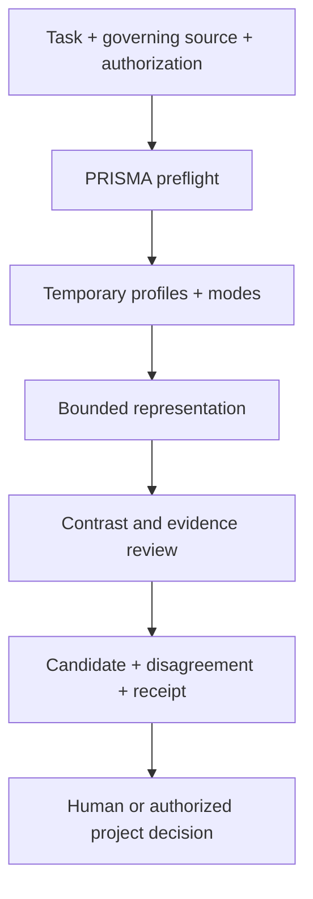

# Architecture

PRISMA owns the method for representation; the domain owns facts, canon, local state and permissions. AOP owns execution routing when intentionally consulted. Moon Source owns its own context-governance methods. Moon Cortex may index PRISMA after verified publication; discovery is not governance or installation. No mandatory external dependency. A host may run a single model or real delegated workers; their existence and independence must be verified, never inferred from profiles.

The temporary profile is a working representation, not an identity registry. The method can change the roster on each task. The reference gate checks mechanical constraints only, while human/editorial review checks source fidelity and output. Persistence is separate from simulation. Public distributions contain generic instructions and synthetic examples only.
